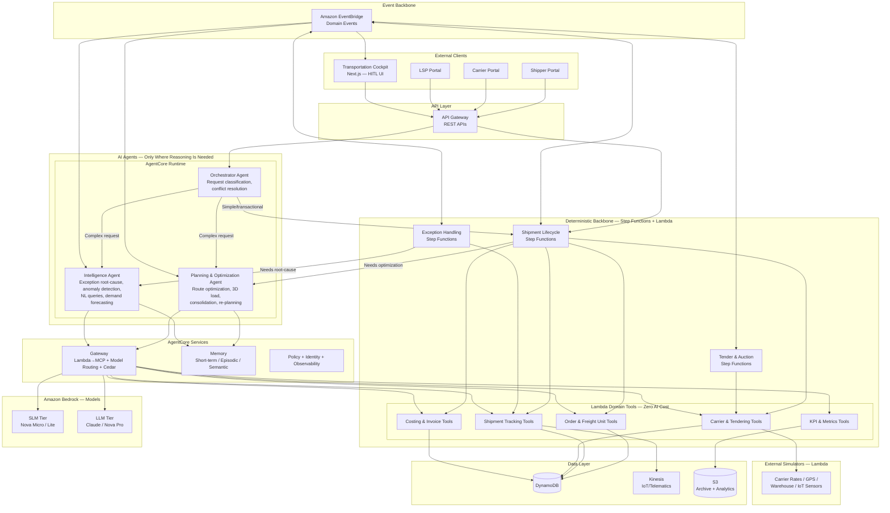
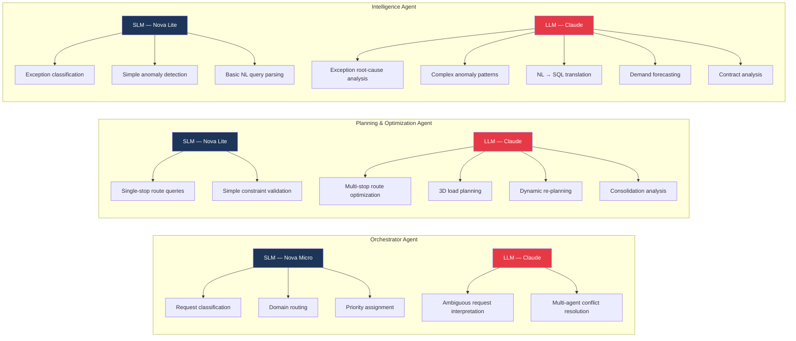
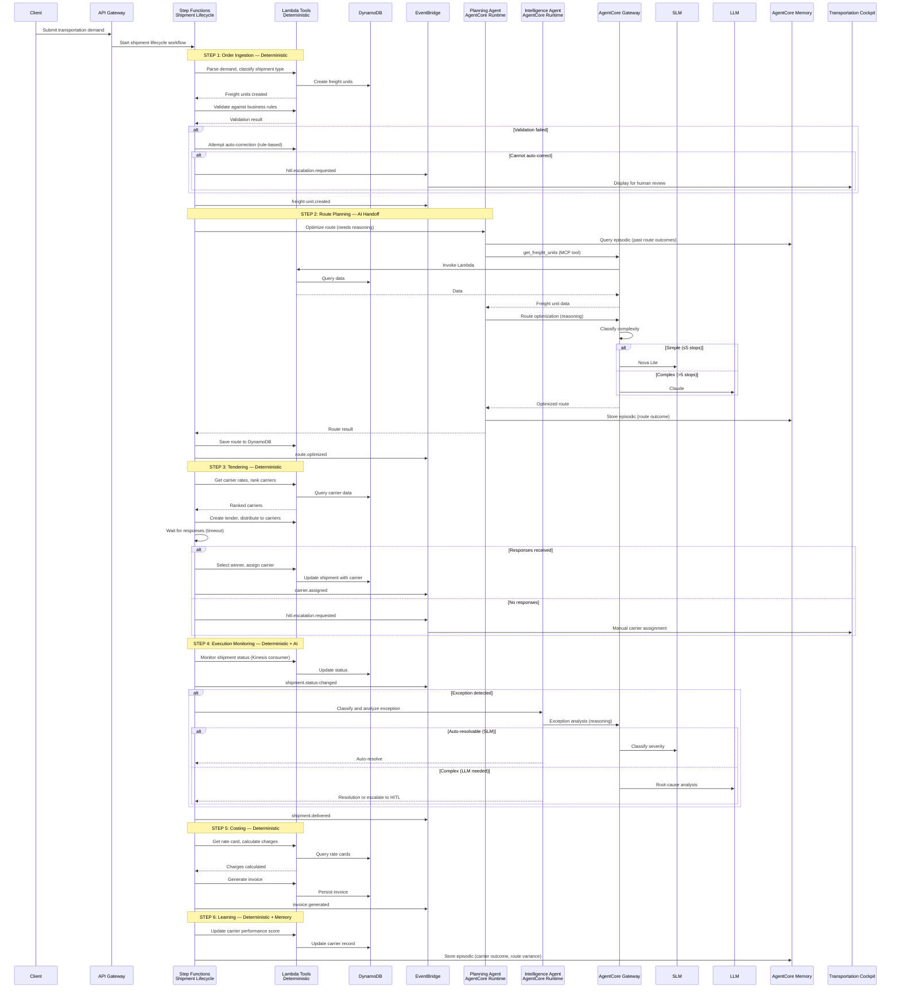
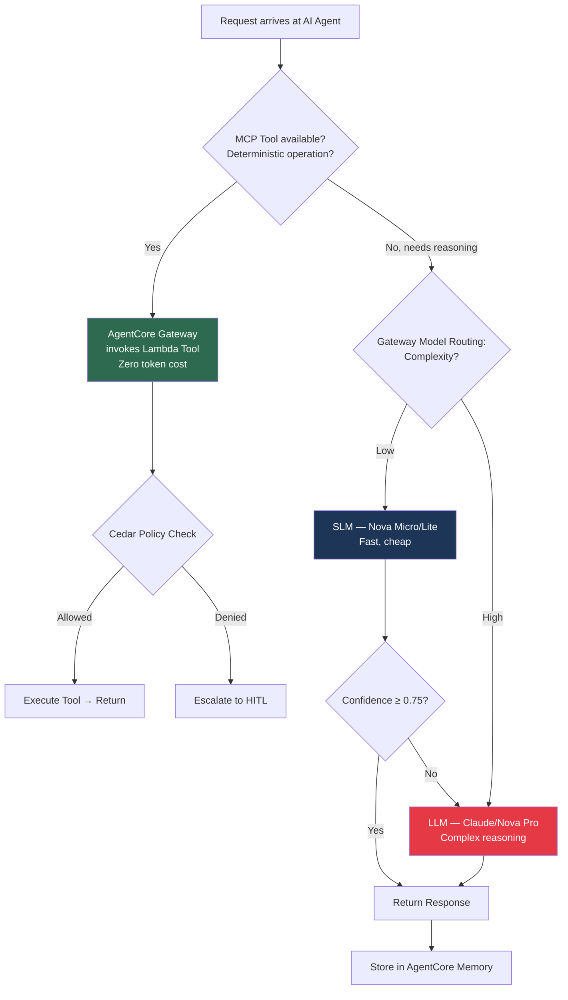
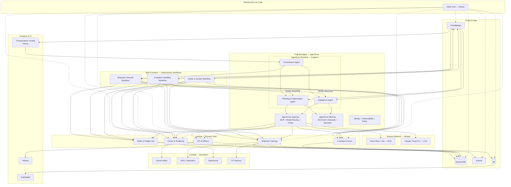
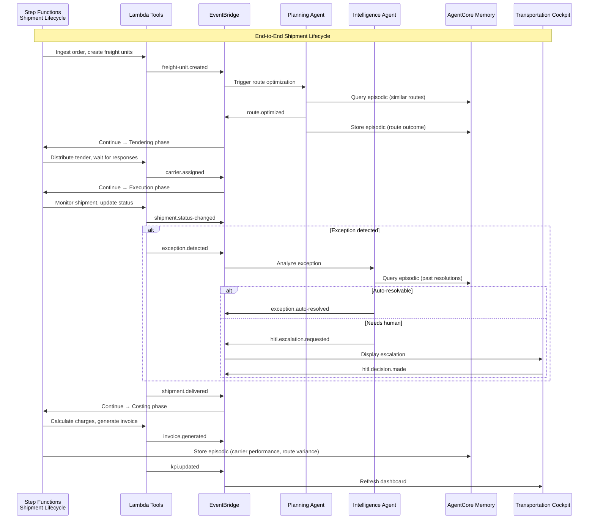
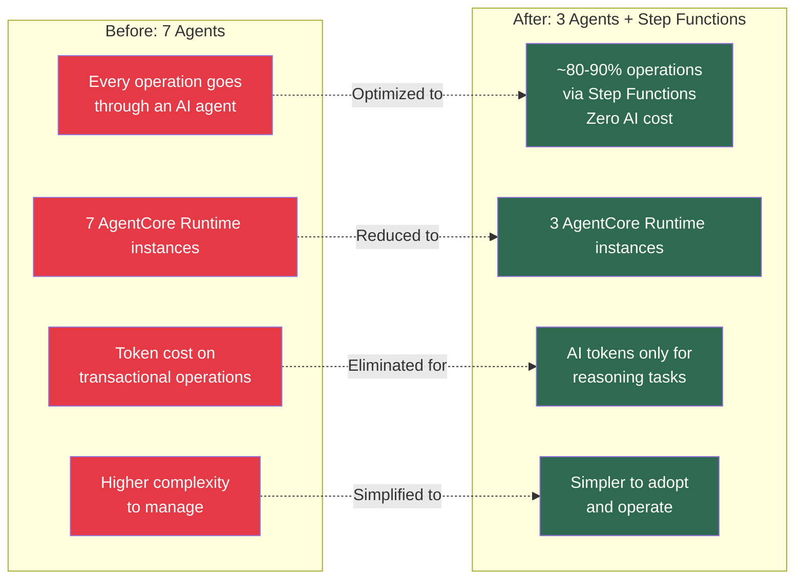

# Enterprise TMS - Architecture Diagrams (Consolidated)

> **Scope:** These diagrams depict the architecture the repository deploys via `cdk deploy` — including the Next.js cockpit (S3 + CloudFront, Cognito auth), API Gateway, Kinesis, S3, AppSync (real-time UI), and AgentCore Memory. QuickSight dashboards are an optional documented follow-on connected to the deployed Athena tables (not provisioned by the stack). See [README-MVP.md](../README-MVP.md).

## Design Philosophy

Most TMS operations are deterministic and transactional — they don't need AI. This architecture uses Step Functions + Lambda for the deterministic backbone (~80-90% of operations at zero AI cost) and only 3 AI agents for tasks that genuinely require reasoning. SLMs handle most reasoning cheaply; LLMs are reserved for complex multi-constraint problems.

---

## 1. High-Level System Architecture (Consolidated)

---

## 2. Deterministic vs AI Split — What Goes Where

```mermaid
flowchart TD
    REQ[Incoming TMS Request] --> CLASS{Request Type?}

    CLASS -->|Transactional / CRUD| SF_PATH[Step Functions + Lambda<br/>Zero AI Cost]
    CLASS -->|Needs Reasoning| AGENT_PATH[AI Agent<br/>AgentCore Runtime]

    subgraph "Step Functions Path — ~80-90% of Operations"
        SF_PATH --> SF_OPS
        SF_OPS[Deterministic Operations]
        SF_OPS --> OP1[Create/update freight units]
        SF_OPS --> OP2[Shipment status updates]
        SF_OPS --> OP3[Distribute tenders to carriers]
        SF_OPS --> OP4[Enforce tender deadlines]
        SF_OPS --> OP5[Assign carrier to shipment]
        SF_OPS --> OP6[Calculate charges from rate cards]
        SF_OPS --> OP7[Generate invoices]
        SF_OPS --> OP8[Settlement summaries]
        SF_OPS --> OP9[Compute KPIs from data]
        SF_OPS --> OP10[Publish events to EventBridge]
        SF_OPS --> OP11[Audit logging]
        SF_OPS --> OP12[Validate business rules]
    end

    subgraph "AI Agent Path — ~10-20% of Operations"
        AGENT_PATH --> AG_OPS
        AG_OPS[Reasoning Required]
        AG_OPS --> AI1[Multi-stop route optimization]
        AG_OPS --> AI2[3D load planning]
        AG_OPS --> AI3[Dynamic re-planning on disruptions]
        AG_OPS --> AI4[Exception root-cause analysis]
        AG_OPS --> AI5[Anomaly pattern detection]
        AG_OPS --> AI6[Natural language queries]
        AG_OPS --> AI7[Demand forecasting]
        AG_OPS --> AI8[Complex carrier analysis]
        AG_OPS --> AI9[Load consolidation optimization]
        AG_OPS --> AI10[Ambiguous request classification]
    end

    style SF_PATH fill:#2d6a4f,color:#fff
    style AGENT_PATH fill:#e63946,color:#fff
    style SF_OPS fill:#2d6a4f,color:#fff
    style AG_OPS fill:#e63946,color:#fff
```

---

## 3. The Three AI Agents — Scope and Model Usage

---

## 4. Shipment Lifecycle — Step Functions Backbone with AI Handoff

---

## 5. SLM/LLM Decision Flow (via AgentCore Gateway)

---

## 6. AWS Deployment Architecture (Consolidated)

---

## 7. Event-Driven Flow (Consolidated)

---

## 8. Cost Comparison — 7 Agents vs 3 Agents + Step Functions

